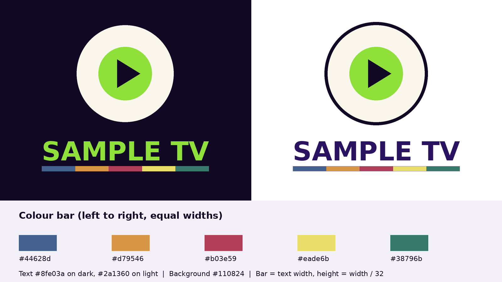

# brand-kit-generator

One badge in, a whole logo package out.

Give it a round badge (transparent PNG), a name and a colour bar. It builds every logo file a small channel, station or brand needs, for dark and light backgrounds, and zips it.



## What you get

| Folder | Files |
|---|---|
| `dark-backgrounds/`, `light-backgrounds/` | Wordmark with colour bar, stacked logo (badge over name), horizontal logo, full logo on a background |
| `bar/` | The colour bar alone: PNG, PNG with a keyline for light backgrounds, SVG |
| `web-and-social/` | Avatars 512 and 1024, banner 1500×500, share image 1200×630, video player logo 250×70 |
| `broadcast/` | Posters 1280×720 and 1920×1080, semi-transparent watermarks for a TV corner bug |
| root | A reference sheet showing the colours and rules, and a README |

Every logo is built from the same proportions, so they all match.


## Use

```bash
pip install -r requirements.txt
python3 brand_kit.py --badge my-badge.png --name "MY CHANNEL"
```

Options:

```
--colours      colour bar, left to right   (default: #44628d,#d79546,#b03e59,#eade6b,#38796b)
--text-dark    wordmark on dark            (default: #8fe03a)
--text-light   wordmark on light           (default: #2a1360)
--background   brand background            (default: #110824)
--font         bold .ttf for the wordmark  (default: DejaVu Sans Bold)
--out          output folder               (default: brand-kit, zip made alongside)
```

Try it with the sample:

```bash
python3 brand_kit.py --badge examples/sample-badge.png --name "SAMPLE TV"
```

## Design rules it follows

- The colour bar is always the width of the text, and its height is width ÷ 32, so it reads as one unit with the name.
- On light backgrounds the bar gets a thin dark keyline, so a pale colour (yellow) doesn't disappear.
- Two text colours: one for dark backgrounds, one for light. Never the same file on both.
- The player logo and watermarks are transparent PNGs, ready for a video player overlay or a broadcast logo (e.g. ffplayout's *Add logo*).

## Requirements

Python 3.8+ and Pillow. Uses DejaVu fonts by default (`fonts-dejavu-core` on Debian/Ubuntu); on Windows or macOS pass `--font` and `--font-regular` with any .ttf.

## Licence

MIT. See [LICENSE](LICENSE). Use your own badge and fonts you have the rights to.
